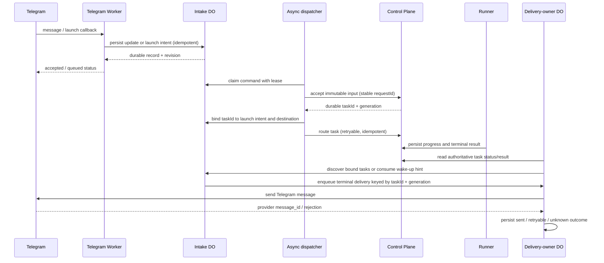

# Telegram task lifecycle: durable asynchronous handoff

Status: target architecture for the Telegram → Control Plane → Runner → Telegram path.
This document is the contract for the migration; it does not claim that the
current production route already satisfies it.

## Decision

Make every remote boundary asynchronous from the user's point of view. The
Telegram webhook and callback handler persist input or a launch intent, return a
clear acknowledgement, and do not wait for Control Plane admission, Runner
placement, model execution, or result delivery. Background dispatch and
reconciliation continue from durable state after request completion, Worker
restart, timeout, or lost callback.

This does not mean making every function fire-and-forget. Durable Object
transactions and state transitions stay serialized and awaited. Only remote
work moves behind a durable command/queue boundary; the caller waits until its
own record is safely committed, then returns.

Keep one authoritative owner per kind of state:

| State | Owner | Other components may do |
|---|---|---|
| Raw Telegram update deduplication and unsent draft | Intake Durable Object | Append, display, or request launch |
| Launch intent and admission attempt | Durable launch-command record in Intake DO | Dispatcher leases and advances it |
| Accepted task, execution status, result, generation | Control Plane task store | Runner reports updates; Telegram Worker reads status/result |
| Telegram destination and delivery attempt | Telegram delivery-owner Durable Object | Reconciler enqueues; owner sends and records provider receipt |
| User-facing status | Projection of the records above | Handlers render it; they do not infer it from an in-flight HTTP request |

Runner never sends Telegram messages and never owns the destination. The
Control Plane is authoritative for task/result state. The Telegram Worker is
authoritative for the mapping from a task to a Telegram destination and for
delivery. Push callbacks and alarms are wake-up hints, not proof of completion.

## Request and result flow

The user-facing acknowledgement means only that the Worker durably accepted the
input or launch intent. It must not say that the Runner has started until CP has
durably accepted the task. Later status changes are rendered from durable
records, for example `queued → accepted → running → completed → delivered`.

## State machines

### Launch command

Each launch command is immutable in identity and input and has a stable
`requestId`, `profileId`, conversation ID, destination, snapshot revision, and
creation time. Its durable state is one of:

`queued → dispatching(lease) → accepted(taskId, generation) → routed`

Terminal or recoverable alternatives are:

- `rejected`: CP definitively refused before creating a task. Keep the draft and
  show a retry action.
- `unknown`: the request may have reached CP but no receipt was observed. Query
  CP by the same `requestId`; never mint a second ID or blindly submit again.
- `routing_pending`: CP accepted the task, but placement/routing is not
  confirmed. Keep the task binding and retry route independently.
- `quarantined`: identity, profile, destination, or immutable input binding
  conflicts. Do not dispatch or deliver automatically.

The dispatcher uses a lease with an expiry and compare-and-swap revision. A
lease only coordinates workers; it does not indicate that the command completed.
After a crash, another dispatcher may reclaim an expired lease and continue
using the same request ID. The CP acceptance endpoint must be idempotent on
`(profileId, requestId)` and return the existing receipt on retries. If CP cannot
provide that guarantee, an ambiguous submission remains `unknown` for lookup or
operator recovery; it is never resubmitted as a new task.

### Task and delivery

The CP task store owns task lifecycle and generation. The Telegram Worker
reconciler observes it independently of the launch request. A terminal task
creates one delivery intent per `(taskId, generation, kind)` in the owner DO.
The owner validates the stored task/destination/profile binding before sending.

Delivery states are `pending → sending → sent`, with `retryable`, `unknown`, and
`quarantined` branches. A Telegram success response plus provider message ID is
required for `sent`. A lost response after send is `unknown`: do not blindly
resend because Telegram `sendMessage` has no client idempotency key; reconcile
provider evidence where available or require explicit safe recovery. Preserve
all attempts and provider IDs.

## Failure and retry rules

- Duplicate Telegram `update_id` returns the previously stored outcome.
- Duplicate callback or launch uses the same command `requestId` and cannot
  create another CP task.
- Worker restart resumes queued commands, expired leases, routing retries, and
  pending deliveries from Durable Object storage.
- A lost Runner push does not block completion: scheduled reconciliation reads
  CP status/result. A push only accelerates that read.
- CP outage leaves a visible queued/retrying command. It does not leave the
  Telegram request hanging and does not discard the draft.
- Telegram outage leaves a visible delivery-pending result. It does not rerun
  the task.
- All retry policies are bounded or expose an explicit long-lived degraded
  state; retry count, next attempt, and last reason are durable and observable.
- No layer treats HTTP 200 from health, callback acknowledgement, or a successful
  enqueue as proof that a task ran or a result was delivered.

## Current gap and migration boundary

The current `intake_run` callback acknowledges Telegram and then awaits
`IntakeBuffer /flush`. That path may enter `_dispatch`, call `handleMessage`,
persist a CP snapshot/receipt, bind the task, and attempt routing before the
request returns. Intake also maintains a busy/barrier lifecycle, while the CP
task store and delivery owner maintain their own durable state. The
`existing-ux` Worker has a scheduled reconciler and a durable delivery owner,
but the launch path still depends on the callback → Intake → CP synchronous
handoff. The production canary demonstrated a state where the callback was
owned and acknowledged but the draft remained pending with no CP task.

Migration must reuse the existing Intake Durable Object, CP receipt API,
Control Plane task store, scheduled Worker trigger, and delivery-owner DO.
Introduce a durable launch-command/outbox and independent dispatcher first.
Keep the old callback route as a compatibility adapter that records the command
and returns its durable status. Then move task binding and recovery to the new
state machine, make reconciler the only completion authority, and retire
duplicate task-lifetime state from Intake only after production E2E proves
restart recovery. Do not replace the current route with a second controller or
move Telegram credentials into CP/Runner.

## Acceptance criteria

1. Webhook and callback return after durable acceptance, within the Worker
   request budget, even when CP or Runner is unavailable.
2. Killing the Worker after each durable transition resumes the same request
   and never creates a duplicate task or repeats completed model work.
3. A CP timeout after possible acceptance resolves by the stable request ID;
   it never creates a fresh task automatically.
4. CP/Runner outage and Telegram delivery outage are independently visible and
   independently recoverable.
5. Terminal result is read from CP, delivered by the owner, and recorded with a
   Telegram provider message ID. Task execution is not repeated on delivery
   retry.
6. Wrong profile, bot, chat, generation, or task binding is quarantined.
7. Production test proves: real Telegram update → durable launch record → one CP
   task → one successful Runner run → persisted result → one confirmed Telegram
   send. Synthetic webhook acceptance is reported separately from real Telegram
   ingress evidence.

## Implementation order

1. Make current no-op dispatch reasons durable and observable; retain the
   current launch guard while measuring the live failure.
2. Specify and implement the launch-command record, idempotency key, lease,
   recovery lookup, and bounded backoff in Intake DO.
3. Move CP admission and route into the asynchronous dispatcher; callback only
   persists and reports the command state.
4. Make task reconciliation and delivery-owner enqueue use the accepted task
   binding as their sole authority; keep the wake-up push advisory.
5. Add crash-point tests at every transition, then canary one isolated test
   account through real Telegram ingress and delivery before widening rollout.
